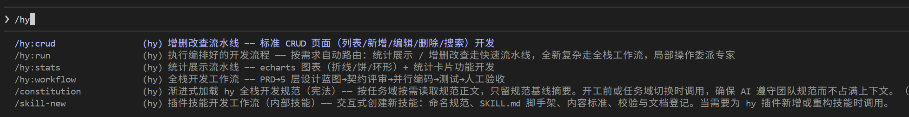
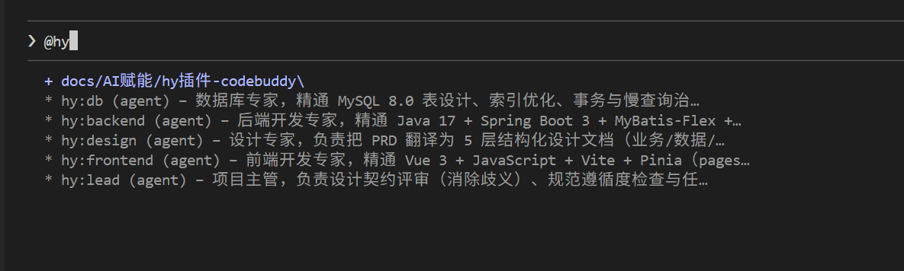
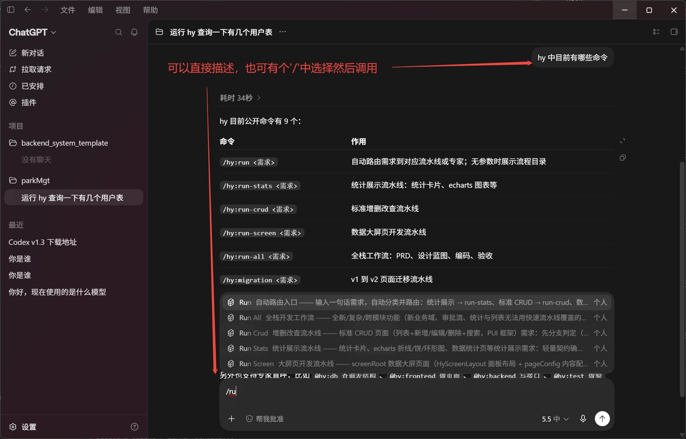
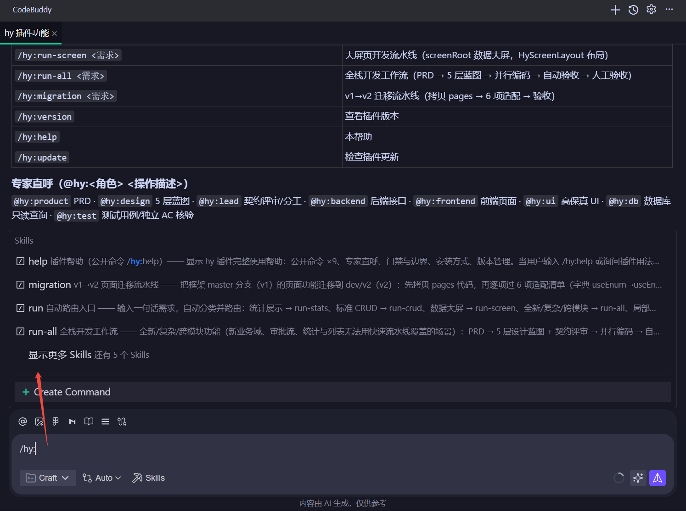

## Claude Code安装

Windows PowerShell：

```powershell
powershell -ExecutionPolicy Bypass -Command "Invoke-WebRequest -Uri 'http://10.1.34.16:30021/AI%E8%B5%8B%E8%83%BD/hy%E6%8F%92%E4%BB%B6/install.ps1' -OutFile $env:TEMP\hy-install.ps1; & $env:TEMP\hy-install.ps1"
```

Git Bash / macOS / Linux：

```bash
curl -fsSL "http://10.1.34.16:30021/AI%E8%B5%8B%E8%83%BD/hy%E6%8F%92%E4%BB%B6/install.sh" | sh
```

> 注意：静态文件地址不带 `/docs/` 前缀（页面地址才带 `/docs/`）。

装完执行 `/hy:update` 更新版本。 注意重启一下claude
###### 工作流

###### 智能体


## codex 安装

Windows PowerShell：

```powershell
powershell -ExecutionPolicy Bypass -Command "Invoke-WebRequest -Uri 'http://10.1.34.16:30021/AI%E8%B5%8B%E8%83%BD/hy%E6%8F%92%E4%BB%B6-codex/install.ps1' -OutFile $env:TEMP\hy-codex-install.ps1; & $env:TEMP\hy-codex-install.ps1"
```

Git Bash / macOS / Linux：

```bash
curl -fsSL "http://10.1.34.16:30021/AI%E8%B5%8B%E8%83%BD/hy%E6%8F%92%E4%BB%B6-codex/install.sh" | sh
```

装完**必须**做两件事：

1. 在 codex 会话中运行 `/hooks`，逐个批准 2 个门禁 hook 信任（不批准 = 门禁不执行 = AI 可能直接 push）
2. 重启 codex 会话

**用法差异**：Codex **没有斜杠命令**，用自然语言触发 —— 说「运行 hy 自动路由：<需求>」/「运行 hy 增删改查流水线：<需求>」等，完整命令映射见 `~/.codex/AGENTS.md`。



## codeBuddy 安装

> 命令格式与 Claude Code 兼容（`/hy:run` 等直接可用）。

Windows PowerShell：

```powershell
powershell -ExecutionPolicy Bypass -Command "Invoke-WebRequest -Uri 'http://10.1.34.16:30021/AI%E8%B5%8B%E8%83%BD/hy%E6%8F%92%E4%BB%B6-codebuddy/install.ps1' -OutFile $env:TEMP\hy-cb-install.ps1; & $env:TEMP\hy-cb-install.ps1"
```

Git Bash / macOS / Linux：

```bash
curl -fsSL "http://10.1.34.16:30021/AI%E8%B5%8B%E8%83%BD/hy%E6%8F%92%E4%BB%B6-codebuddy/install.sh" | sh
```

装完重启 CodeBuddy 生效。

**注意事项**：

- 项目级技能必须放**工作区根目录** `.codebuddy/skills/`
- 门禁为提示级（PostToolUse 无法阻止），深度依赖门禁拦截的场景优先用 Claude Code

###### 工作流



## 三平台对照表

> 常见命令在 Claude Code / Codex / CodeBuddy 三平台的使用差异与注意事项：
> [常见命令三平台使用对照表](commands-matrix.md)


## 怎么用（公开命令 ×9 + 专家直呼）

> 说明：所有流程都内置前后端条件分支 —— 可只实现前端，可只实现后端，全栈则两端一起交付。启动流程时说明范围即可，流程会自动裁剪。

| 命令 | 作用 |
|------|------|
| `/hy:run <需求>` | **自动路由**：拿不准走哪个流程时用它，自动分类；不带参数会列出全部流程目录 |
| `/hy:run-stats <需求>` | 统计展示流水线：echarts 折线/饼/环形图 + 统计卡片 |
| `/hy:run-crud <需求>` | 增删改查流水线：标准 CRUD 页（列表/新增/编辑/删除/搜索） |
| `/hy:run-screen <需求>` | 数据大屏页流水线：screenRoot 模块 + HyScreenLayout 布局 |
| `/hy:run-all <需求>` | 全栈开发工作流：PRD → 5 层设计蓝图 → 并行编码 → 人工验收 |
| `/hy:migration <需求>` | v1→v2 迁移流水线：<需求> 为需要迁移的内容描述 |
| `/hy:version` | 查看插件版本 |
| `/hy:help` | 完整使用帮助（命令/专家/门禁/安装/版本管理） |
| `/hy:update` | 检查插件更新（比对文档站 version.json，给出升级指引） |
| `@hy:<角色> <操作>` | 直接调用专家（frontend/backend/db/test/design/lead/ui/product）—— 改搜索框、修接口、写脚本等 |

### 怎么选

- 高度相似的功能（第 N 个统计页 / CRUD 页）→ `/hy:run-stats` / `/hy:run-crud` 直达，或 `/hy:run` 自动路由
- 数据大屏页（screenRoot 模块）→ `/hy:run-screen`，或 `/hy:run` 自动路由
- 全新 / 复杂 / 跨模块功能 → `/hy:run-all`，或 `/hy:run` 自动路由
- v1→v2 页面迁移（老框架功能迁到 v2 分支）→ `/hy:migration`，或 `/hy:run` 自动路由
- 局部修改 / 说不清的小操作 → `@hy:<角色> <操作描述>` 直接委派

### 常见使用

> 日常高频场景速查（数据库查询 / 字典查询 / 设计图还原 / 更多）：
> [常见使用说明](usage.md)

### 约定

- **git 提交由你人工执行**：AI 只准备变更摘要和测试结果，提交权在你（门禁自动拦截 AI 的 commit/push）
- **数据库只读**：AI 只通过 MCP 查询表结构，DDL/DML 变更出方案后由你执行
- **人工验收**：流程结束会列出验收清单，你逐条确认通过才算交付

## 常见问题

- 输入 `/hy` 只看到 `run` 一个命令？→ 旧版缓存，`/reload-plugins` 或重启会话
- 要用 `@hy:db 查表结构`？→ 需先写入访问 token（找插件维护者要【测试环境接口】token）：`node ~/.hcoder/plugin/mcp/hy-db-tools/server.js --set-token <token>`（Windows 为 `~\.hy\plugin\...`）
- 安装脚本报错？→ 确认网络可达 `10.1.34.16:30021`，或联系插件维护者