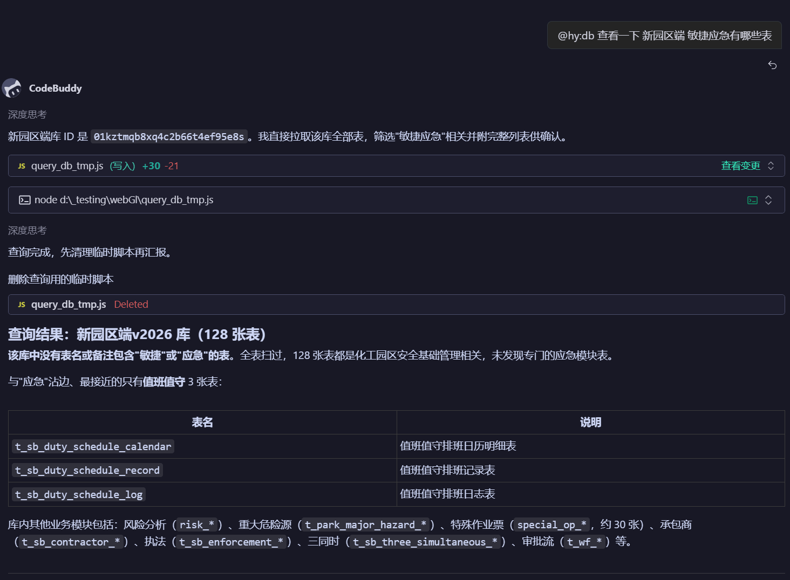

# 常见使用说明

> hy 插件日常使用频率最高的场景速查：数据库查询、字典查询、设计图还原。
> 命令在三个平台（Claude Code / Codex / CodeBuddy）的用法差异见 [三平台命令对照表](commands-matrix.md)；MCP 服务完整触发说明见 [内部使用的 MCP 服务](../MCP服务/)。

## 1. 数据库【库】【表】查询

开发前先让 AI 通过工具获取目标表的结构/字段信息，再按字段写页面、接口，避免凭记忆开发。

**Prompt 示例**：

> 通过工具获取【审批表单配置表】的信息

**使用要点**：

- 触发方式：`@hy:db` 专家直呼，或流程内自动触发（`run-crud` 表格字段梳理、`run-all` 数据设计前）
- 工具：`lookup_table_fields(表名/关键词)` 按表名或中文备注模糊搜索字段信息；`list_databases()` 列出可用数据库连接
- 首次使用需写入访问 token（找插件维护者要【测试环境接口】token）：
  `node ~/.hcoder/plugin/mcp/hy-db-tools/server.js --set-token <token>`（Windows 为 `~\.hy\plugin\...`）
- Token 失效时查询会立即停下向你要 token，写入后立即生效、无需重启
- 只读查询表结构/字段；DDL/DML 变更仍只出方案，由人工执行

## 2. 字典查询（enterprise-dict）

表单下拉 / 单元格回显 / 筛选条件 / 后端枚举字段需要可选值时，先查字典确认枚举是否已存在。

**使用要点**：

- `list_dicts_by_system`：用前端项目 `src/global/constant.js` 的 APP_NAME 查**当前微服务所有字典**（去 `-web` 作 systemFlag）
- `get_dict_options`：查询字典详情
- 新增字典：`create_dict`（新增字典集）/ `create_dict_item`（完善字典项）—— **必须人工确认**；提供系统编码、实体名、字段名和值（如 1-可用，2-禁用）
- 字典编码结构：`{系统编码}__{实体名}__{字段名}`
- 使用 Trae 需切换智能体为 **build with mcp**
- 禁止：猜测枚举值（描述不清先问用户）、新增**其他系统**的字典

## 3. 设计图还原（figma）

有 Figma 设计稿时，`@hy:ui` 专家读取设计稿提取视觉规范（design token），实现像素级高保真 UI。

**使用要点**：

- 触发方式：`run-screen` 步骤 6（设计图确认）、`run-all`（有设计稿时）、直接 `@hy:ui <需求>`
- 工具：`mcp__figma__*`（本地 `http://127.0.0.1:3845/mcp`，需桌面端 Figma 客户端配合）
- 提取的视觉规范**必须沉淀为文本**（`.claude/design/04-ui/visual-spec.md` 或样式 token），AI 与后续编码只认文本
- 设计稿缺失/未授权/连接不可用时如实说明，改用 `04-ui/` 契约 + 项目设计系统兜底，不阻塞交付

## 4. 更多场景（待补充）

> 其他常用场景将在此追加（含截图与触发说明）。如需补充，联系文档维护者或在仓库提交 PR。
