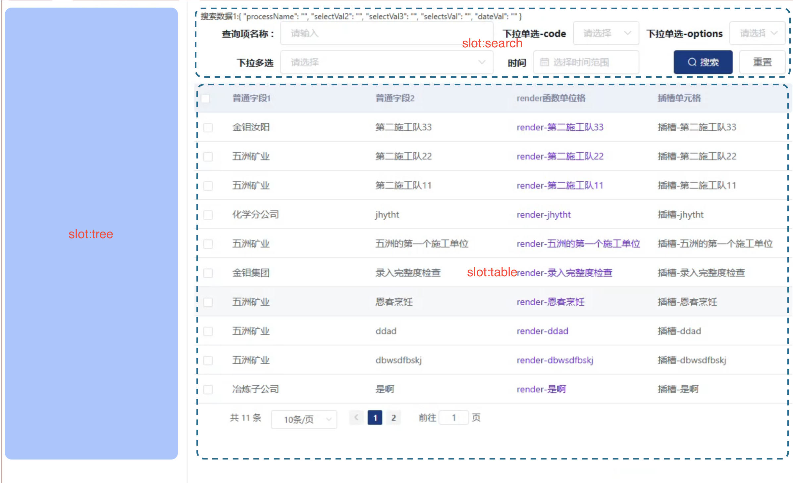

# Pui 组件库

::: tip
同时支持vu2、vue3，使用方式基本一致
<br />
一个项目一个版本包 [见仓库](http://10.2.163.218:4873/)
:::


## 介绍

基于[`vue2`](https://v2.cn.vuejs.org/v2/guide/render-function.html) [`elementUi`](https://element.eleme.cn/#/zh-CN/component/form) 快速开发组件库；用于支持`公司PC业务 前端快速开发`

## 特点

- 参数最少化，上手简单；`全部组件`均支持对应[`element组件`](https://element.eleme.cn/#/zh-CN/component/table)的所有属性配置。
   - PuiTable|PuiTable 均可当作 ElTable 一样使用
   - PuiSearch | PuiForm 中的[`表单项`](./Form/jsons配置.md)也支持； 
   `如: 配置了{ele:Input}则支持 ElInput的全部属性{'属性名':'属性值'}`
- 多种使用模式，灵活多变
    - [PuiTable](./Table/index.md)支持`api模式` `tableDate模式` 
    - [PuiTablePage](./TablePage/index.md)支持`api模式` `tableDate模式` `纯布局模式`
    - [PuiForm](./Form/index.md)支持 `完整表单模式` `表单组模式`，同时支持`add` `edit` `view` `自定义`表单状态
- `全局组件`提升代码可维护性；[`render函数`](https://v2.cn.vuejs.org/v2/guide/render-function.html)方式开发，提升了渲染性能
- 基于`芋道生成代码`或`老项目代码`，[快速生成配置](./配置生成工具/index.md)，免去了对接数据库字段的工作

## 快速上手
```js

import '@hy-pui/vue3-code-gen' /** 自动全局注册了 */
import '@hy-pui/vue3-code-gen/lib/style.css'

createApp(App).use(ElementPlus).use(Pui,{
    pageShim: { pageNo: 'pageIndex', pageSize: 'pageSize' },
    totalShim:'res.totalCount',
    apiResShim: 'res.data'
    // tablePageTreeWidth: 300,
    // puiSearchStyle: 'pop',
    // isDev: true,
    // tablePageTreeDrag: false
    // searchAdvancedAll: true,
    // tablePageSize: 33, 
}).mount('#app')

```

## 快捷导航
- 组件： [`布局表格`](./TablePage/index.md) [`简单表格`](./Table/index.md) [`查询组件`](./Search/index.md) [`表单组件`](./Form/index.md)

- 配置：[`表格的配置`](./Table/index.md) [`render中按钮`](./Del/index.md) [`查询配置`](./Search/index.md) [`表单完整配置`](./Form/jsons配置.md) 
- 工具：[`表格\表单配置生成工具`](./配置生成工具/index.md)

## 完整的代码示例


./indev.vue 主页面 [`布局表格`](./TablePage/index.md) [`简单表格`](./Table/index.md) [`查询组件`](./Search/index.md) [`表单组件`](./Form/index.md)
```vue
<template>
  <div class="app-container">
    <PuiTablePage :columns="columns" :api="apiList" :apiParams="apiParams" :hasPage="true" :optBtns='optBtns'  @optBtnClick="optBtnClick"  @select="onSelect" @select-all="onSelect" ref="puiTablePage">
    <!--   <template v-slot:tree> pui-tree 根据项目业务再开发--处理所有的树结构 </template> -->

      <template v-slot:search>
        <PuiSearch v-model="searchObj" :jsons="searchJsons" @reset="onSearch" @search="onSearch" :labelWidth="100" />
      </template>

      <template v-slot:slotUser="{ row, index, prop }"> 插槽-{{ row.unitName }} </template>
    </PuiTablePage>

    <el-dialog :visible.sync="diaObj.visible" :title="diaObj.title" width="800px" :before-close="diaClose" append-to-body >
      <PuiForm ref="puiForm" v-model="formData" :jsons="formJsons" :status="formStatus" @submit="onSubmit" @reset="onReset" @input="onFormDataOther" :inline="false" label-position="right" label-width="150px" />
    </el-dialog>

  </div>
</template>
<script>
// import PuiTablePage from '../TablePage'
// import PuiSearch from '../Search'
// import PuiForm from '../Form'
import { columns, optBtns, searchJsons, formJsons } from './resource'
import { getLedgerList as apiList, apiCreate } from "@/api/business/daily/outsource/ledger"
export default {
//   comments: {
//     PuiTablePage,
//     PuiSearch,
//     PuiForm
//   },
  data() {
    return {
      apiList,
      apiParams:{},
      columns: columns(this), /** 不需要render中执行methods中的方法的 可以直接声明个数组 */
      optBtns,
      tableData: [1,2,3],
      searchJsons,
      searchObj: {},
      diaObj: { visible: false, title: '查看' },
      formData: {},
      formJsons,
      formStatus: 'add',

      demoVal: null,
    }
  },
  methods: {
    optBtnClick(type, d){
      switch (type) {
        case 'view':
          this.formStatus = type
          this.formData = { ...d } /** 必须使用...解构，不然在 resetForm()时 会遇到浅拷贝问题 */
          this.diaObj.title = '详情'
          this.diaObj.visible = true
          break
        case 'add':
          this.diaObj.title = '新增'
          // this.$refs?.puiForm?.resetForm() /** puiForm 取消点击时 已经执行了reset 初始化表单值 */
          this.formStatus = type
          this.diaObj.visible = true
          break

        default:
          break
      }
    },
    onFormDataOther(data, key, otherData) {
      console.log('pui form 配置key之外的值', key, otherData)
      switch (key) {
        case 'companyId':
          this.formData['companyName'] = otherData?.label /** 获取表单的扩展值 如:下拉获取选中Object */
          break

        default:
          break
      }
    },
    onSelect(arr, obj) {
      console.log('pui table:', arr, obj);
    },
    onSearch(obj) {
      this.apiParams = { ...obj, searchTimestamp: new Date().getTime() } /** 注意解构obj, 避免浅拷贝 触发请求接口; searchTimestamp保障触发接口更新 */
    },
    onShowEdit(row) {
      this.formData = row
      this.diaObj.visible = true
    },
    onSubmit(obj) {
      console.log('form submit data:', obj, this.formData)
      apiCreate(obj).then((res) => {
        this.diaObj.visible = false
        this.$refs.puiTablePage?.loadData()
      })
    },
    onReset() {
      console.log('form reset data:', this.formData)
      this.diaObj.visible = false
    },
    diaClose() {
      this.diaObj.visible = false
      this.$refs?.puiForm?.resetForm()
    }
  }
}
</script>
```

./resource.js 相关配置 [`表格的配置`](./Table/index.md) [`render中按钮`](./Del/index.md) [`查询配置`](./Search/index.md) [`表单完整配置`](./Form/jsons配置.md) [`表格 表单配置生成工具`](./配置生成工具/index.md)
```js
/** 表格构造器 **/
export const columns = (event) => {
  return [
    { type: 'selection'},
    { label: '普通字段1', prop: 'companyName' },
    { label: '普通字段2', prop: 'unitName' },
    {
      prop: 'opt', label: 'render函数单位格', render: (h, row) => {
        return h('span',{style:{color:'#771cf3'}, on: { click: () => {event.onShowEdit(row)} }}, `render-${row.unitName}`)
      }
    },
    { slotName:'slotUser', label: '插槽单元格'},
  ]
}

/** 操作按钮权限 operate */
export const optBtns =[
  {opt:'add', permission:'use:add'},
  {opt:'del', permission:'use:del'},
  {opt:'dels', permission: true},
  {opt:'ddd', slotName:'optBtnSlot'}, // 支持插槽
  {opt:'自定义操作', name:'操作名称'}, // 支持自定义按钮
] 

/** 查询表单构造器 **/
export const searchJsons = [
  {
    ele: 'Input',
    key: 'processName',
    label: '查询项名称',
    // labelWidth: 90,
    placeholder: '请输入',
    span: 12, //布局 8/24
    colon:true
  },
  {
    ele: 'Select',
    key: 'selectVal2',
    label: '下拉单选-code',
    placeholder: '请选择',
    span: 6,
    multiple:false,
    // code: 'risk_point_level', //查询下拉的code， 已废弃，可使用ele传入组件的方式 或 动态options 或 options 指定为方法
    // codeShim:'id', //字典值垫片  指定选择项的值【默认值是id】
   
  },
  {
    ele: 'Select',
    key: 'selectVal3',
    label: '下拉单选-options',
    placeholder: '请选择',
    span: 6,
    multiple:false,
    options: [
      {value:'11',label:'男'},
      {value:'12',label:'女'},
    ],
  },
  {
    ele: 'Select',
    key: 'selectsVal',
    label: '下拉多选',
    placeholder: '请选择',
    span: 12,
    multiple:true,
    options: [
      {value:'11',label:'类型1'},
      {value:'12',label:'类型2'},
    ],
  },
  {
    ele: 'DatePicker',
    key: 'dateVal',
    label: '时间',
    placeholder: '选择时间范围',
    span:6,
    labelWidth: 40,
    type: 'date',
    format:"yyyy 年 MM 月 dd 日",
    //理论上支持elDatePicker 所有配置,以[属性名]:[属性值]方式使用
  },
]

/** 表单构造器 **/
export const formJsons = [
  {
    ele:'Input',
    key: 'inputVal',
    label: '输入框',
    // 'label-width': '100px'
    placeholder: '请输入',
    defaultVal:'123',
    // controls_disabled: { add: true, edit: false, view: false },
    // controls_show: { add: false, edit: true, view: true }, // function方式 隐藏时会删除formData[key]的属性
    propVal: [
      { required: true, message: '必须', trigger: 'blur' },
      { min: 3, max: 5, message: '3到5个长度', trigger: 'blur' }
    ],
    span: 8,
    // slotName:'',
    // type:
  },
  {
    ele:'Input',
    key: 'textareaVal',
    label: '文本框',
    // 'label-width': '100px',
    placeholder: '请输入',
    defaultVal:'123',
    span: 8,
    type:'textarea',
    // controls_disabled: { add: true, edit: false, view: false },
    // controls_show: { add: false, edit: true, view: true }, // function方式 隐藏时会删除formData[key]的属性
    propVal: [
      { required: true, message: '必须', trigger: 'blur' },
    ],
    // slotName:'',
    // 个性化属性...
    maxlength:'500',
    "show-word-limit":true,
    autosize:{ minRows: 5, maxRows: 6 }
  },
  {
    ele:"Select",
    key: "selectOptionVal",
    label: "下拉单选-options",
    // "label-width": "100px",
    placeholder: "",
    defaultVal:"",
    span: 8,
    slotName:"",
    options:[
      {value:'11',label:'男'},
      {value:'12',label:'女'},
    ]
  },
  {
    ele:"Select",
    key: "selectOptionVal2",
    label: "下拉多选-options",
    // "label-width": "100px",
    placeholder: "",
    defaultVal:"",
    span: 8,
    multiple:true,
    slotName:"",
    options:()=>[
      {value:'11',label:'男'},
      {value:'12',label:'女'},
    ]
  },
//   {
//     ele:'Select',
//     key: 'selects2Val',
//     label: '下拉多选-字典',
//     // labelWidth: 
//     span: 8,
//     placeholder: '',
//     defaultVal:'',
//     controls_disabled: { add: false, edit: false, view: false },
//     controls_show: { add: true, edit: true, view: true }, // function方式 隐藏时会删除formData[key]的属性
//     multiple:true,
//     propVal: [
//       {
//         required: true,
//         message: 'Please select Activity zone',
//         trigger: 'change',
//       },
//     ],
//     slotName:'',
//     // 个性化属性...
//     //  code: 'risk_point_level', 已废弃，可使用ele传入组件的方式 或 动态options 或 options 指定为方法
//     //  codeShim:'id', //字典值垫片  指定选择项的值【默认值是id】
//   },
  {
    ele: 'DatePicker',
    key: 'dateTimeVal',
    label: '日期时间',
    labelWidth: 40,
    placeholder: '选择时间',
    span:8,
    type: 'datetime',
  },
  {
    ele: 'DatePicker',
    key: 'datetimerangeVal',
    label: '日期区间选择',
    placeholder: '日期区间选择',
    span: 8,
    type: 'datetimerange',
    'range-separator':'到',
    format:"YYYY/MM/DD",
    'value-format':"YYYY-MM-DD",
  },
  { 
    ele: 'Cascader',
    key: 'companyName', 
    label: '级联选择', 
    span: 12, 
    propVal: [], 
    // code: 'org' /** 系统中几种常见类型 org：组织机构树 */ 已废弃
    // options:[],
    // disabledIds: [100] /** 禁用节点的id */
    filterable: true, /** 支持 elCascader 所有配置项 */
    clearable: true,
    props: { checkStrictly: true,  multiple: false }
  },
  {
    ele: 'CheckboxGroup',
    key: 'checkboxVal',
    label: '复选框组',
    defaultVal:[],
    options:[
      {label:'选项1', value:'type1'},
      {label:'选项2', value:'type2'},
      {label:'选项3', value:'type3'},
    ]
  },
  {
    ele: 'RadioGroup',
    key: 'radioVal',
    label: '单选框组',
    defaultVal:'',
    span: 12,
    options:[
      {label:'单选项1'/* 理论上支持所有el-radio属性 */},
      {label:'单选项2'},
      {label:'单选项3'},
    ]
  },
  { 
    ele: 'Editor', 
    key: 'editerHtml', 
    label: '富文本内容框', 
    span: 24
  },
  { 
    ele: 'UploadFiles',
    key: 'content', 
    label: '上传文件内容', 
    span: 12 
  },
   { 
    // ele: '',
    // key: '',
    label: '不填写插槽占用整个区域',
    slotName:'插槽名称' /** 标点项插槽 */
    span: 24,
   }
  // {
  //   ele: 'UploadFile',
  //   key: 'fileVal',
  //   label: '文件上传和回显',
  //   defaultVal:null,
  //   span:12,
  // }
]

```
