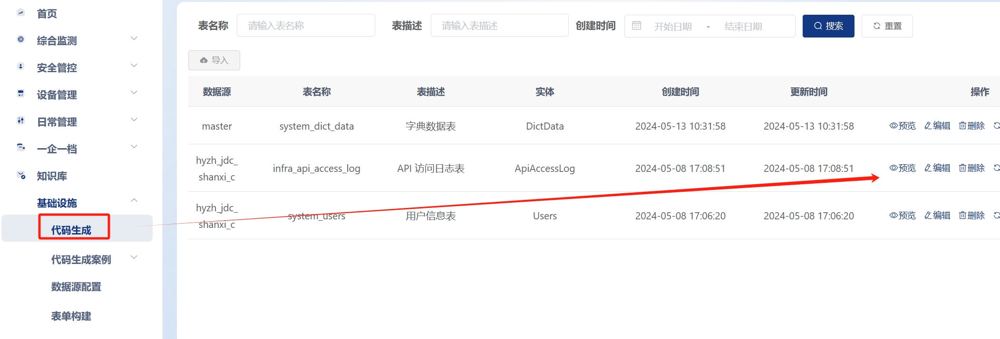
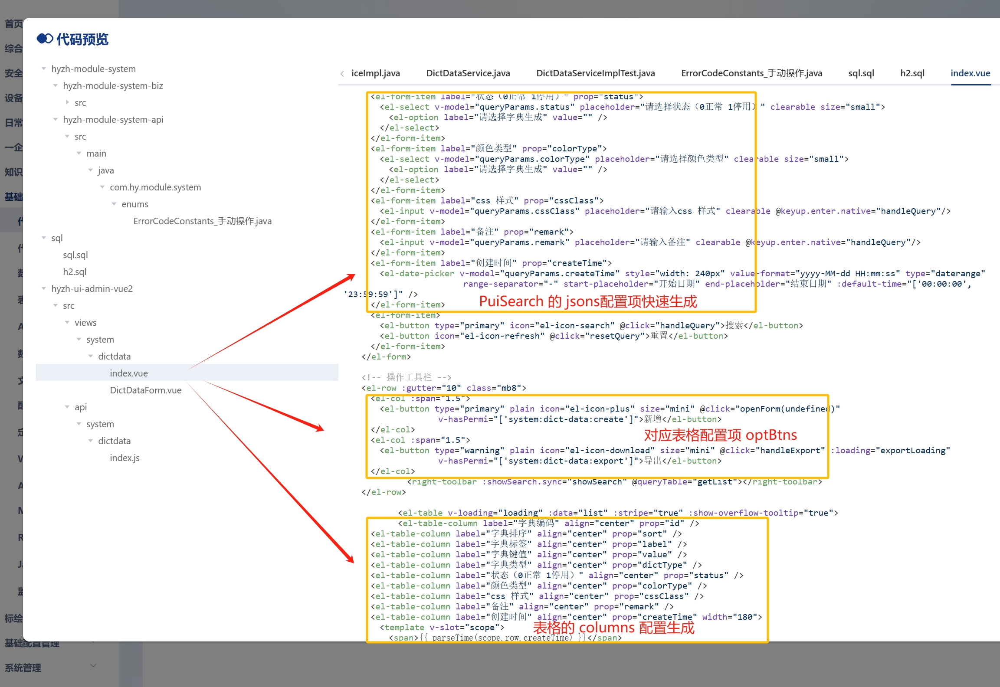
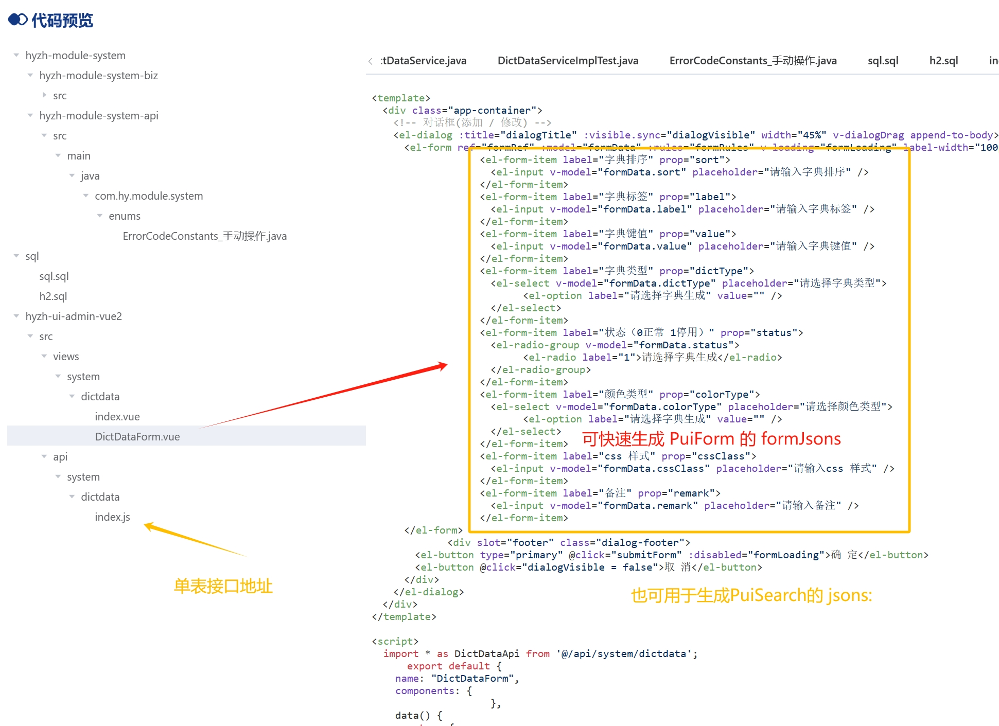

<script setup>
import helper from '../../../components/helper.vue'
import Aiuse from '../../../components/Aiuse.vue'
</script>

## AI 代码生成工具
<Aiuse />

## 配置生成工具


基于 [芋道前端vue2项目-基础设施-代码生成-预览] 自动生成代码，无需对接字段；也可以用于改造老代码 
```
重要：不用对字段，不用对字段，不用对字段！！！
```

<helper />


## **老项目工具使用说明**
- 可将`老的项目代码`，使用本工具快速转换成Pui组件
- 可在一下位置`预览代码`后，使用本工具转换成Pui组件配置


***PuiTable PuiTablePage PuiSearch 生成配置所需代码***


***PuiForm PuiSearch 生成配置可用代码***
