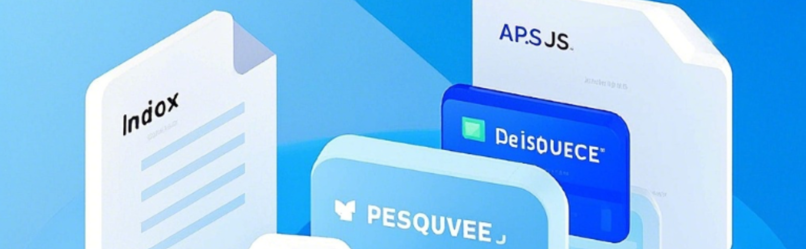

# 低代码建设



[`低代码平台`](http://10.1.34.16:30023/code-gen/) + [`PUI`](http://10.2.163.218:4873/-/web/detail/@hy-pui/vue3-code-gen) + [`backend_system_template项目模版`](http://10.2.163.10:30300/enterprise-v8/backend_system_template/src/branch/master/README.md) 实现低代码的产出、升级和运行

> ## 低代码平台 
 - [代码使用示例](http://10.2.163.10:30300/enterprise-v8/backend_system_template/src/branch/master/src/pages/pageDemo)
 - [系统访问地址](http://10.1.34.16:30023/code-gen/)
 - 产出物说明
  ```js
    - index.vue    // 页面
    - apis.js      // 接口
    - resource.js  // 配置
    - i18n         // 多语言配置，不需要可直接删除
  ```
  

> ## PUI包
  - [通用配置说明](./des.md)
  - [npm包地址](http://10.2.163.218:4873/-/web/detail/@hy-pui/vue3-code-gen), 较新的改动，请进入后【版本更新记录】中查看
  - [pui文档地址](/PUI%E7%BB%84%E4%BB%B6%E5%BA%93/)

> ## 项目模版 [backend_system_template](http://10.2.163.10:30300/enterprise-v8/backend_system_template/src/branch/master/README.md)
  - 统一登录 [maxKey](http://10.1.34.16:30012/maxkey-mgt/#/passport/login)
  - src/api/useAPI [前后端接口基类](http://10.1.34.16:30200/doc.html#/code-gen/%E7%A4%BA%E4%BE%8B%E8%A1%A8%E6%8E%A5%E5%8F%A3/page)
  - src/api/useTablePage 通用交互抽离[hook](http://10.2.163.10:30300/enterprise-v8/backend_system_template/src/branch/master/src/api/useTablePage.js) （不可修改）
  - src/hook/useEnum 通用枚举字典[hook](http://10.2.163.10:30300/enterprise-v8/backend_system_template/src/branch/master/src/hooks/useEnum/readme.md) [字典项维护地址](http://10.1.34.16:30014/system///#/main/dictionary)（不可修改）
   - src/hook/useCrossPageCall 跨页面调用[hook](http://10.2.163.10:30300/enterprise-v8/backend_system_template/src/branch/master/src/hooks/useEnum/readme.md) [字典项维护地址](http://10.1.34.16:30014/system///#/main/dictionary)（不可修改）

  > ## 使用的项目列举

  - [`物联网平台`](http://10.1.34.16:30024/iot/)
  - [`智能影音平台`](http://10.1.34.16:30020/smart-av/)
  - [`后台管理系统`](http://10.1.34.16:30014/system/)
  - [`双重预防管控系统`](http://10.1.34.16:30013/dubcontrol/)
  - [`重大危险源`](http://10.1.34.16:30028/hazcore/)
  - [`特殊作业`](http://10.1.34.16:30027/specialwork/)
  - [`泸天化项目`](http://10.1.34.16:30030/supervise/)
  - [`螺栓监测系统`](http://10.1.34.16:30038/bolt-monitor-web/)
  - ...


