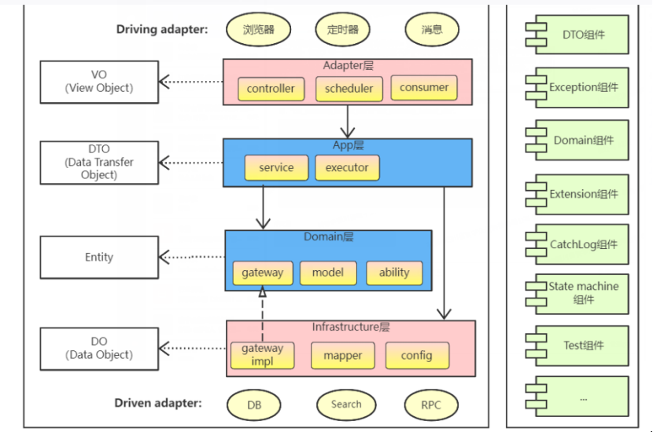

## 项目结构

## 1. 项目结构图


## 2. 目录结构
```
enterprise-demo
├─adapter
│  ├─src
│  │  └─main
│  │      └─java
│  │          └─com
│  │              └─demo
│  │                  └─adapter
│  │                      ├─openapi
│  │                      └─web
├─app
│  ├─src
│  │  ├─main
│  │  │  └─java
│  │  │      └─com
│  │  │          └─demo
│  │  │              └─app
│  │  │                  ├─cmd
│  │  │                  │  └─qry
│  │  │                  ├─convert
│  │  │                  └─service
├─client
│  ├─src
│  │  └─main
│  │      └─java
│  │          └─com
│  │              └─demo
│  │                  └─client
│  │                      ├─api
│  │                      ├─dto
│  │                      │  ├─cmd
│  │                      │  │  └─qry
│  │                      │  └─data
│  │                      └─vo
├─deploy
├─domain
│  ├─src
│  │  └─main
│  │      └─java
│  │          └─com
│  │              └─demo
│  │                  └─domain
│  │                      ├─gateway
│  │                      └─model
├─infrastructure
│  ├─src
│  │  └─main
│  │      ├─java
│  │      │  └─com
│  │      │      └─demo
│  │      │          └─infrastructure
│  │      │              ├─config
│  │      │              ├─listener
│  │      │              └─repository
│  │      │                  ├─convert
│  │      │                  ├─dataobject
│  │      │                  ├─gatewayimpl
│  │      │                  ├─mapper
│  │      │                  └─service
│  │      │                      └─impl
│  │      └─resources
│  │          └─mapper
├─starter
│  ├─src
│  │  ├─main
│  │  │  ├─java
│  │  │  │  └─com
│  │  │  │      └─demo
│  │  │  │          └─starter
│  │  │  │              ├─exception
│  │  │  │              └─interceptor
│  │  │  └─resources
```

## 3. 项目层级说明

3.1适配层（Adapter Layer）

负责对前端展示（web，wireless，wap）的路由和适配，对于传统B/S系统而言，adapter就相当于MVC中的controller；

3.2 应用层（Application Layer）

主要负责获取输入，组装上下文，参数校验，调用领域层做业务处理，如果需要的话，发送消息通知等。层次是开放的，应用层也可以绕过领域层，直接访问基础实施层；

3.3 领域层（Domain Layer）

主要是封装了核心业务逻辑，并通过领域服务（Domain Service）和领域对象（Domain Entity）的方法对App层提供业务实体和业务逻辑计算。领域是应用的核心，不依赖任何其他层次；

3.4 基础实施层（Infrastructure Layer）

主要负责技术细节问题的处理，比如数据库的CRUD、搜索引擎、文件系统、分布式服务的RPC等。此外，领域防腐的重任也落在这里，外部依赖需要通过gateway的转义处理，才能被上面的App层和Domain层使用。

## 技术栈
框架主要用到的技术栈举例如下：
- spring 生态中的 spring boot spring cloud作为项目的基础框架
- nacos 作为配置中心和注册中心
- mybatis-flex 作为orm框架
- xxl-job
- 其他的技术都是可以通过组件的方式来进行引入使用

## 代码生成
代码生产的类放在 CodeGenTest 类下，全局搜索出来即可

```java
//配置数据源
HikariDataSource dataSource = new HikariDataSource();
dataSource.setJdbcUrl("jdbc:mysql://xxxx:xxxx/xxxx?characterEncoding=utf-8");
dataSource.setUsername("xxx");
dataSource.setPassword("xxx");
//模块名的前缀
String modulePrefix = "";
//业务包名
String busiPackage = "";
//创建配置内容

//linux环境下代码生成路径
GlobalConfig globalConfig = Codegen.createGlobalConfig("D:\\generate", "zhangsan");
//Windows环境下代码生成路径
//GlobalConfig globalConfig = createGlobalConfig("D:\\generate", "zhangsan");
globalConfig.setTablePrefix("t_");
globalConfig.setGenerateTable("t_pr_demo");


TableConfig tableConfig = new TableConfig()
        .setInsertListenerClass(CustomInsertListener.class)
        .setUpdateListenerClass(CustomUpdateListener.class);
globalConfig.setTableConfig(tableConfig);
//通过 datasource 和 globalConfig 创建代码生成器
CustomGenerator generator = Codegen.createGenerator(dataSource, globalConfig);
CustomGlobalConfig customGlobalConfig = generator.getCustomGlobalConfig();
customGlobalConfig.setBusiPackage(busiPackage);
customGlobalConfig.setModulePrefix(modulePrefix);
// 注册构建器
Codegen.registerAllGenerator(globalConfig, customGlobalConfig);
//生成代码
generator.generate();
// 打开生成的代码
Desktop.getDesktop().open(new File(globalConfig.getSourceDir()));
```
## 生产接口
1. 创建数据表
2. 使用代码生成器生产代码
3. 复制到项目中

经过如上步骤我们可以获取到这个表实体对应的一系列接口

## 自定义接口

代码的调用链路如下：

adapter->app-[domain(可选)]->infrastructure

正常我们自定义接口有两个方面
## 1. 重写已经有的接口
    1. 重写分页接口
        1. 重新app层的QryExe
            
            在app层创建一个QryExe, 只要是查询相关都必须遵从结尾, 将类创建到com.xxx.app.cmd.qry 包下, 比如叫 DemoCustomPageQryExe
            ```
             /**
               * DemoCustomPageQryExe
               *
               * @author linc
               * @since 2025/7/25 18:00
               */
             @Component
             @AllArgsConstructor
             public class DemoCustomPageQryExe {
    
                 /**
                   * 命令执行
                   * @param cmd cmd
                   * @return List<PrDemoVO>
                   */
                 public PageResponse<PrDemoVO> execute(PrDemoPageQry cmd) {
                     return xxxx;
                 }
    
             }
             // 然后在对应实体的serviceImpl中重新page方法
             private final DemoCustomPageQryExe customPageQryExe;

             @Override
             public PageResponse<PrDemoVO> page(PrDemoPageQry cmd) {
                  return customPageQryExe.execute(cmd);
             }
           ```
            按照如上逻辑，定义一起其他的CmdExe 或者 QryExe 也是这种方式， CmdExe 结尾表示非查询类命令实现，QryExe 结尾表示查询类命令实现           

        2. 替换sql语句
         
            比如我们的需求只是需要重新查询的sql，我们可以做如下操作
            ```
            // 找到对应实体的BaseQryExe, 比如我这里的实体是PrDemo, 那么找到类PrDemoBaseQryExe
            @Component
            public class PrDemoBaseQryExe extends BaseQryExe<PrDemoVO, PrDemoDTO, PrDemoModel, PrDemoDO, PrDemoAppConvert, IPrDemoRepoService, PrDemoOneQry, PrDemoPageQry, PrDemoExcelExportQry> {
            
                @Override
                public boolean customPageQueryWrapper(QueryWrapper queryWrapper, TableInfo tableInfo, PrDemoPageQry cmd) {
                    // 自定义分页查询条件或者sql， 以下为示例, QueryWrapper的使用方式可以参阅官方文档
                    queryWrapper.where(PrDemoDOTableDef.PR_DEMO_DO.NAME.like(cmd.getName()))
                            .and(PrDemoDOTableDef.PR_DEMO_DO.REMARK.likeLeft(cmd.getRemark()));
                    return true;
                }
            }
            // 如果我们需要重新定义返回的VO对象， 此时我们需要想第一点一样重新page方法
            @Service
            @AllArgsConstructor
            public class PrDemoServiceImpl extends ServiceImpl<PrDemoVO, PrDemoDTO, PrDemoModel, PrDemoDO, PrDemoAppConvert, IPrDemoRepoService, PrDemoBaseCmdExe, PrDemoBaseQryExe, PrDemoOneQry, PrDemoPageQry, PrDemoExcelExportQry> implements IPrDemoService {
            
                @Override
                public PageResponse<PrDemoVO> page(PrDemoPageQry cmd) {
                    // 调用指定响应类进行查询
                    return baseQryExe.executePageQryAs(cmd, PrDemoVO.class);
                }
            }
           
           ```
            按照上面的描述，就可以完成自定义分页接口了

    2. 重写新增接口
   
        新增接口的定义和分页类似，框架提供了对应实体类的BaseCmdEx, 例如PrDemoBaseCmdExe，重新编写一个CmdExe的方式不在赘述，下面讲一下重写新增方法
        
        找到类PrDemoBaseCmdExe, 重新对应的方法
        ```
       /**
       * PrDemoBaseCmdExe
       *
       * @author linc
       * @since 2025/2/28 16:24
       */
         @Component
         public class PrDemoBaseCmdExe extends BaseCmdExe<PrDemoVO, PrDemoDTO, PrDemoModel, PrDemoDO, PrDemoAppConvert, IPrDemoRepoService> {
    
                 @Override
                 public Object executeAdd(BaseCmd<PrDemoDTO> cmd) {
                     return super.executeAdd(cmd);
                 }
         }
          ```
       比如重写修改，删除等也是相同的做法
    3. 重写其他方法
        
       框架主要提供了两个类：BaseCmdExe 和 BaseQryExe ,里面提供了新增，修改，删除，导入，导出，分页，列表查询等方法，如果框架的实现不符合我们需求，那么我们就需要重新定义
## 2. 完全自定义

    完全自定义就是自己建一个CmdExe 或者 QryExe 然后在 ServiceImpl中进行调用

## 3. 重写导出

默认的导出方法是基于分页查询的sql进行导出，我们日常开发中可能会遇到替换sql, 或者重写将数据写入到excel的逻辑

```java
// 参照重写分页查询sql的方法重写方法 customExportQueryWrapper
@Override
public boolean customExportQueryWrapper(QueryWrapper queryWrapper, TableInfo tableInfo, PrDemoExcelExportQry cmd) {
    // 重写后返回true, 否则不生效
    return true;
}
// 如果需要重写数据写入到excel的逻辑
@Override
public boolean customExportDataWrite(ExcelWriter excelWriter, WriteSheet writeSheet) {
    // 重写导出逻辑

    return true;
}

```


## 4. 自定义导出

有些时候，我们需要单独写一个导出接口，可参考如下方式

baseQryExe 提供了一个 静态方法executeCustomExcelExport, 用于自定义导出方法
```java
// 以下为举例包保责任制导出， 此处使用了 BaseQryExe.executeCustomExcelExport 自定义了导出
//1. 定义QryExe
/**
 * 包保责任制导出
 *
 * @author linc
 * @since 2025/6/16 13:43
 */
@Component
@AllArgsConstructor
public class PrRiskAnalysisTaskDefendExcelExportQryExe {

    private final PrRiskAnalysisTaskBaseQryExe taskBaseQryExe;

    /**
     * 命令执行
     * @param cmd cmd
     */
    public void execute(PrRiskAnalysisTaskExcelExportQry cmd, OutputStream outputStream) {
        BaseQryExe.executeCustomExcelExport(outputStream, cmd, pair -> {
            ExcelWriter excelWriter = pair.getKey();
            WriteSheet writeSheet = pair.getValue();
            PrRiskAnalysisTaskPageQry pageQry = PrRiskAnalysisTaskAppConvert.INSTANCE.toPageQry(cmd);
            pageQry.setTenantId(SecurityUtil.getTenantId());
            pageQry.setPageIndex(1);
            pageQry.setPageSize(5000);

            Page<PrRiskAnalysisTaskVO> page;
            do {
                page = taskBaseQryExe.queryPage(pageQry);
                List<PrRiskAnalysisTaskVO> records = page.getRecords();
                List<List<String>> dataList = new ArrayList<>();
                if (CollUtil.isNotEmpty(records)) {
                    // 数据处理
                    dataList = records.stream().map(item -> {
                        List<String> data = new ArrayList<>();
                        data.add(item.getTroubleshootContent());
                        data.add(item.getCheckCycle() + "天");
                        if(Objects.nonNull(item.getEffectiveTime())) {
                            String format = LocalDateTimeUtil.format(item.getEffectiveTime(), "yyyy-MM-dd HH:mm:ss");
                            data.add(format);
                        } else {
                            data.add("-");
                        }
                        return data;
                    }).toList();
                }
                // 写入到excel
                excelWriter.write(dataList, writeSheet);
                // 设置下一页
                pageQry.setPageIndex(pageQry.getPageIndex() + 1);
            } while (page.hasNext());
        });
    }
}
// 2. 定义service
@Override
public void defendExcelExport(PrRiskAnalysisTaskExcelExportQry cmd, OutputStream out) {
    taskDefendExcelExportQryExe.execute(cmd, out);
}
// 3. 定义controller
@Operation(summary = "包保责任制任务导出")
@PostMapping("defend/excel/export")
public void defendExcelExport(@RequestBody PrRiskAnalysisTaskExcelExportQry cmd, HttpServletResponse response) {
    customExcelExport(cmd, response, pair -> service.defendExcelExport(pair.getKey(), pair.getValue()));
}

```

5. customParams 在自行定义查询的使用

在新版本框架中，前端会使用 customParams 来自定义参数，可以自行指定sql 操作符如 = like > 等, 但是在某些特殊场景下，需要覆盖重新查询语句，如重写customPageQueryWrapper
来改变查询语句和查询条件，这个时候默认的解析 customParams 的方法就会失效，此处对如何在自定义查询的方法中如何使用 customParams 进行说明

示例中，通过调用 BaseQryExe.getConditionAndConnect, 传入 自定义参数列表，以及表信息，QueryTable, 还要要将条件拼接到哪个 QueryCondition 上，就可以获取一个拼接好的条件

```java
QueryCondition whereCondition = QueryCondition.createEmpty();
BaseQryExe.getConditionAndConnect(cmd.getCustomParams(), tableInfo, t1, whereCondition);
```
此处传入t1, 是因为需要生成的sql 会自动拼接为 t1.columnName 的方式， 然后最下方又自定义了两个查询条件，没有使用customParams

示例如下：
```java
@Override
public boolean customPageQueryWrapper(QueryWrapper queryWrapper, TableInfo tableInfo, PrDutySchedulePageQry cmd) {
    PrDutyScheduleDOTableDef t1 = PrDutyScheduleDOTableDef.PR_DUTY_SCHEDULE_DO.as("t1");
    PrDutyScheduleStaffDOTableDef t2 = PrDutyScheduleStaffDOTableDef.PR_DUTY_SCHEDULE_STAFF_DO.as("t2");
    // 构建查询语句
    queryWrapper.select(t1.DEFAULT_COLUMNS)
            .from(t1)
            .leftJoin(t2)
            .on(t1.ID.eq(t2.SCHEDULE_ID));

    // 计算查询条件
    QueryCondition whereCondition = QueryCondition.createEmpty();
    BaseQryExe.getConditionAndConnect(cmd.getCustomParams(), tableInfo, t1, whereCondition);

    // 拼接其他需要特殊处理的查询条件
    whereCondition.and(t2.USER_TYPE.eq(PrDutyScheduleStaffDO.UserTypeEnum.LEADER.getCode(), StrUtil.isNotBlank(cmd.getLeaderDutyStaffUserId())).and(t2.USER_ID.eq(cmd.getLeaderDutyStaffUserId(), StrUtil.isNotBlank(cmd.getLeaderDutyStaffUserId()))));
    whereCondition.and(t2.USER_TYPE.eq(PrDutyScheduleStaffDO.UserTypeEnum.STAFF.getCode(), StrUtil.isNotBlank(cmd.getDutyStaffUserId())).and(t2.USER_ID.eq(cmd.getDutyStaffUserId(), StrUtil.isNotBlank(cmd.getDutyStaffUserId()))));

    queryWrapper.where(whereCondition);
    return true;
}
```

## nacos配置说明

nacos 配置分为两块，公共配置和项目自己的配置，bootstrap的配置如下
```
spring:
  application:
    name: 应用名称
  cloud:
    nacos:
      config:
        server-addr: ${NACOS_SERVER_ADDR:10.1.34.16:30848}
        username: ${NACOS_USERNAME:nacos}
        password: ${NACOS_PASSWORD:HYzh248713}
        namespace: ${NACOS_NAMESPACE:enterprise-v8-test}
        file-extension: yaml
        group: ${spring.application.name}
        shared-configs:
          - data-id: public.yaml
            group: DEFAULT_GROUP
            refresh: true
          - data-id: redis.yaml
            group: DEFAULT_GROUP
            refresh: true
          - data-id: datasource.yaml
            group: DEFAULT_GROUP
            refresh: true
          - data-id: app-public.yaml
            group: DEFAULT_GROUP
            refresh: true
```
在公共配置中，redis.yaml 配置了redis的连接信息，datasource.yaml 配置了所有的数据库连接信息

按照上面的配置，在nacos的enterprise-v8-test空间下，会有一个和应用名相同的独立配置文件， 例如双控的配置如下：
```
# mybatis-flex 配置
mybatis-flex:
  datasource:
    mysql:
      type: hikaricp
      url: ${datasource.mysql.url}
      username: ${datasource.mysql.username}
      password: ${datasource.mysql.password}
    postgresql:
      type: hikaricp
      url: ${datasource.postgresql-enterprise-v8-pg.url}
      username: ${datasource.postgresql-enterprise-v8-pg.username}
      password: ${datasource.postgresql-enterprise-v8-pg.password}
server:
  port: 2002
# 调度中心配置
xxl:
  job:
    enabled: ${XXL_JOB_ENABLED:false}
    executor:
      appname: ${spring.application.name}
      # 多网卡时可指定ip
      #ip: 10.0.10.30
      access-token: default_token
    admin:
      addresses: http://${XXL_JOB_ADMIN_HOST:10.1.34.16}:${XXL_JOB_ADMIN_PORT:30015}/xxl-job-admin/
      #addresses: http://xxl-job-admin:8080/xxl-job-admin/

# kafka
spring:
  kafka:
    # 指定一个属性用于启用kafka
    enabled: ${KAFKA_ENABLED:false}
    bootstrap-servers: kafka.kafka:9092
    producer:
      key-serializer: org.apache.kafka.common.serialization.StringSerializer
      value-serializer: org.apache.kafka.common.serialization.StringSerializer
      # 失败重试次数
      retries: 3
      # 确保消息完整写入副本
      acks: all
    consumer:
      # 启动多实例时，每个实例的group-id必须相同
      group-id: ${spring.application.name}_group
      key-deserializer: org.apache.kafka.common.serialization.StringDeserializer
      value-deserializer: org.apache.kafka.common.serialization.StringDeserializer
      # 关闭自动提交偏移量，消费完成后，手动提交
      enable-auto-commit: false
      properties:
        # 使用协作粘性策略, 需要kafka版本>=2.4.0
        partition-assignment-strategy: org.apache.kafka.clients.consumer.CooperativeStickyAssignor
        # 当没有偏移量时，从最早的位置开始消费
        auto-offset-reset: earliest
        # 增加会话超时时间（避免频繁重平衡）
        session.timeout.ms: 30000
        heartbeat.interval.ms: 10000
    listener:
      # 手动提交模式
      ack-mode: manual

# 国家专项任务检查
gov-task-api:
  base-url: https://data-sk-wh.scasst.net
  username: MSadmin
  password: MSadmin.123
  company-code: 511410025
```
配置中会引用datasource.yaml中配置的数据库连接信息

如果本地开发要测试，比如要把服务启动到自己的命名空间中，则在starter的resource目录下，创建 application.yaml, 可以覆盖nacos中的配置， application.yaml目录不要提交到代码仓库中

## 部署发版

目前部署都是基于jenkin打包自动调用k8s的接口进行发布，我们主要做的就是初始化任务，这个过程可以交给项目初始化的人员进行统一处理， 开发人员要做的就是登录jenkins找到对应任务进行构建就行
